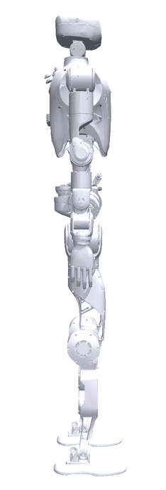
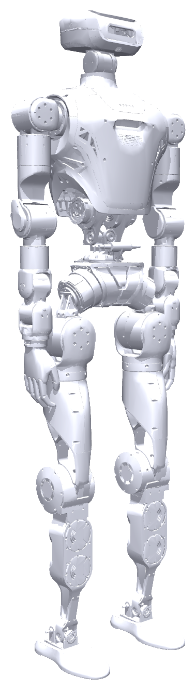
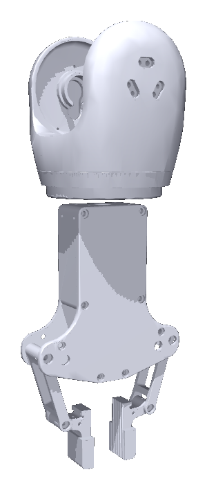
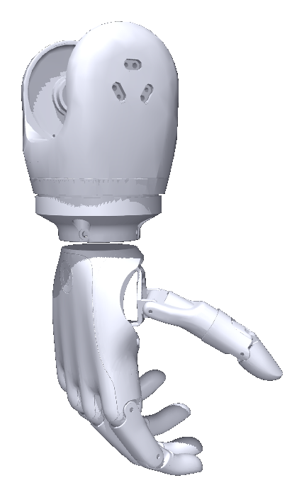
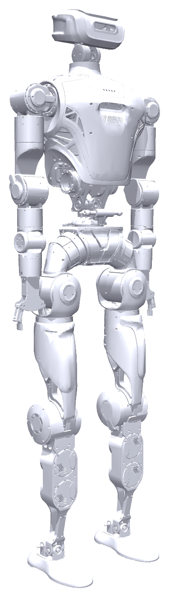
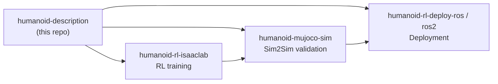

<div align="center">

<picture>
  <source media="(prefers-color-scheme: dark)" srcset="docs/images/hu_d04_turntable_dark.gif">
  
</picture>

# LimX Humanoid Description

**Simulation-ready models of a real, full-size humanoid robot — in URDF, MuJoCo MJCF and USD.**

Drop the LimX HU_D04 into ROS, MuJoCo or NVIDIA Isaac Sim in minutes, with real actuator parameters and the true parallel-linkage ankles.

[](LICENSE)
[](#ros-1--ros-2)
[](#mujoco-30-seconds)
[](#isaac-sim--isaac-lab)
[](https://github.com/limxdynamics/humanoid-description/stargazers)

**English** | [中文](README_cn.md)

[Quick Start](#quick-start) · [Models](#robot-models) · [Specs](#specifications) · [Ecosystem](#ecosystem) · [Citation](#citation)

</div>

---

## Highlights

- **One robot, three formats** — matching URDF, MJCF and USD for the same hardware, so you can train in Isaac Lab, validate in MuJoCo and deploy with ROS without rebuilding the model.
- **Up to 53 joints** — 31-DoF base humanoid (legs, 3-DoF waist, 7-DoF arms, 2-DoF head), plus gripper and 11-joint dexterous hand variants.
- **Real parallel ankles & waist** — the MJCF drives the ankles and waist through their actual A/B push-rod linkages, closed with equality constraints, instead of an idealized serial approximation.
- **Real actuator data** — the SRDF lists rotor inertia and gear ratio for every joint, which matters for accurate sim-to-real transfer.
- **Sim-ready out of the box** — MJCF ships with 31 torque actuators, an IMU (orientation, gyro, accelerometer) and 65 sensors; USD is layered into base / physics / sensor for Isaac Sim.
- **Commercial-friendly** — Apache 2.0.

## Quick Start

```bash
git clone --depth 1 https://github.com/limxdynamics/humanoid-description.git
cd humanoid-description
```

> `--depth 1` is recommended — the meshes and USD files make the full history large.

### MuJoCo (30 seconds)

```bash
pip install mujoco
python -m mujoco.viewer --mjcf=HU_D04_description/xml/HU_D04_01.xml
```

Or load it from Python:

```python
import mujoco

model = mujoco.MjModel.from_xml_path("HU_D04_description/xml/HU_D04_01.xml")
data = mujoco.MjData(model)
print(f"{model.nu} actuators, {model.nsensor} sensors")   # 31 actuators, 65 sensors

for _ in range(1000):
    data.ctrl[:] = 0.0          # joint torques (N·m) — plug in your controller here
    mujoco.mj_step(model, data)
```

> `HU_D04_01.xml` is the full simulation model (actuators, sensors, closed-loop linkages). `HU_D04_01_vis.xml` is a lightweight visualization-only version.

### ROS 1 / ROS 2

Clone into your workspace and build — each `HU_D0x_description` folder is a ROS package that works with both catkin and colcon:

```bash
cd ~/ros_ws/src
git clone --depth 1 https://github.com/limxdynamics/humanoid-description.git
cd ..
catkin_make        # ROS 1
colcon build       # ROS 2
```

View in RViz (ROS 1, requires `urdf_tutorial`):

```bash
roslaunch urdf_tutorial display.launch model:=$(rospack find HU_D04_description)/urdf/HU_D04_01.urdf
```

View in RViz (ROS 2):

```bash
URDF=$(ros2 pkg prefix HU_D04_description)/share/HU_D04_description/urdf/HU_D04_01.urdf
ros2 run robot_state_publisher robot_state_publisher --ros-args -p robot_description:="$(cat $URDF)" &
ros2 run joint_state_publisher_gui joint_state_publisher_gui &
rviz2   # Add → RobotModel, set Fixed Frame to base_link
```

### Isaac Sim / Isaac Lab

Open `HU_D04_description/usd/HU_D04_01.usd` directly in Isaac Sim (**File → Open**), or add it to your stage as a reference. The top-level USD composes the layers in `usd/configuration/` automatically (`sensor → physics → base`), so keep that folder next to it.

For RL training, see [humanoid-rl-isaaclab](https://github.com/limxdynamics/humanoid-rl-isaaclab), which uses these models out of the box.

## Robot models

| | Type | Model | Joints | Formats |
|:-:|---|---|:-:|---|
|  | **HU_D04** full-size humanoid | `HU_D04_01` | 31 | URDF · MJCF · USD |
|  | **HU_D04 + Gripper** | `HU_D04_01_with_gripper` | 39<br><sub>35 independent</sub> | URDF · USD |
|  | **HU_D04 + Dexterous Hand** | `HU_D04_01_with_hand` | 53<br><sub>43 independent</sub> | URDF · USD |
|  | HU_D03 *(discontinued)* | `HU_D03_03` | 31 | URDF · MJCF · USD |

> **Note:** MuJoCo MJCF is currently provided for the base HU_D04 only. HU_D03 is no longer maintained — please use HU_D04 for new projects.

## Specifications

Values below are read from the HU_D04 model files.

| | HU_D04 |
| --- | --- |
| Height (model) | ≈ 1.66 m |
| Mass (URDF, base model) | ≈ 52.5 kg |
| Legs | 2 × 6 DoF (hip pitch / roll / yaw, knee, ankle pitch / roll) |
| Waist | 3 DoF (yaw / roll / pitch) |
| Arms | 2 × 7 DoF (shoulder pitch / roll / yaw, elbow, wrist yaw / pitch / roll) |
| Head | 2 DoF (yaw / pitch) |
| Dexterous hand | 11 joints / 6 independent per hand |
| Parallel linkages | Ankles (A/B push-rods) and waist roll / pitch |

<details>
<summary><b>Joint limits & actuator parameters (click to expand)</b></summary>

<br>

Left side shown; the right side mirrors it.

| Joint | Range (°) | Torque (N·m) | Velocity (rad/s) | Gear ratio |
| --- | --- | --- | --- | --- |
| hip_pitch | −150 ~ 150 | 140 | 5 | 25 |
| hip_roll | −50 ~ 120 | 140 | 5 | 25 |
| hip_yaw | −150 ~ 150 | 140 | 5 | 25 |
| knee | −5 ~ 148 | 140 | 5 | 25 |
| ankle_pitch | −58 ~ 35 | 42 | 13.6 | 36 |
| ankle_roll | −25 ~ 25 | 42 | 13.6 | 36 |
| waist_yaw | −150 ~ 150 | 42 | 13.6 | 36 |
| waist_roll | −30 ~ 30 | 42 | 13.6 | 36 |
| waist_pitch | −30 ~ 45 | 42 | 13.6 | 36 |
| shoulder_pitch | −160 ~ 160 | 42 | 19.6 | 25 |
| shoulder_roll | −5 ~ 185 | 42 | 19.6 | 25 |
| shoulder_yaw | −195 ~ 90 | 42 | 19.6 | 25 |
| elbow | −140 ~ 90 | 42 | 19.6 | 25 |
| wrist_yaw / pitch / roll | −135 ~ 45 / −90 ~ 90 / −90 ~ 90 | 19 | 13 | 28.17 |
| head_yaw / pitch | −45 ~ 45 / −30 ~ 45 | 19 | 13 | 28.17 |

Rotor inertia for each joint is in `urdf/HU_D04_01.srdf`.

</details>

## Repository Structure

```
humanoid-description/
├── HU_D04_description/          # ROS package (catkin + ament)
│   ├── urdf/                    # URDF variants + SRDF (rotor inertia, gear ratio)
│   ├── xml/                     # MuJoCo MJCF (full sim + visualization-only)
│   ├── usd/                     # Isaac Sim USD + configuration/ layers
│   ├── meshes/                  # STL meshes
│   ├── world/                   # Gazebo (SDF) empty world
│   ├── CMakeLists.txt
│   └── package.xml
└── HU_D03_description/          # Legacy model, same layout
```

## Ecosystem

These models are the foundation of LimX's open humanoid stack — train a policy, verify it in a second simulator, then deploy it:



| Repository | What it does |
| --- | --- |
| [humanoid-rl-isaaclab](https://github.com/limxdynamics/humanoid-rl-isaaclab) | Train locomotion policies in Isaac Lab |
| [humanoid-mujoco-sim](https://github.com/limxdynamics/humanoid-mujoco-sim) | MuJoCo simulator for the humanoid |
| [humanoid-rl-deploy-ros](https://github.com/limxdynamics/humanoid-rl-deploy-ros) | Deploy RL policies with ROS 1 |
| [humanoid-rl-deploy-ros2](https://github.com/limxdynamics/humanoid-rl-deploy-ros2) | Deploy RL policies with ROS 2 |

## Citation

If these models help your research, please cite:

```bibtex
@misc{limx_humanoid_description,
  title        = {LimX Humanoid Description: URDF, MJCF and USD Models for LimX Humanoid Robots},
  author       = {{LimX Dynamics}},
  year         = {2025},
  howpublished = {\url{https://github.com/limxdynamics/humanoid-description}}
}
```

## License

Released under the [Apache License 2.0](LICENSE).
