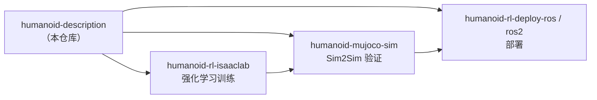

<div align="center">

<picture>
  <source media="(prefers-color-scheme: dark)" srcset="docs/images/hu_d04_turntable_dark.gif">
  
</picture>

# LimX 人形机器人描述文件

**真实全尺寸人形机器人的开箱即用仿真模型 —— URDF、MuJoCo MJCF、USD 三种格式齐全。**

几分钟内把逐际动力 HU_D04 接入 ROS、MuJoCo 或 NVIDIA Isaac Sim，自带真实执行器参数与并联踝关节结构。

[](LICENSE)
[](#ros-1--ros-2)
[](#mujoco30-秒上手)
[](#isaac-sim--isaac-lab)
[](https://github.com/limxdynamics/humanoid-description/stargazers)

[English](README.md) | **中文**

[快速开始](#快速开始) · [模型一览](#模型一览) · [规格参数](#规格参数) · [生态](#生态) · [引用](#引用)

</div>

---

## 亮点

- **一台机器人，三种格式** —— 同一硬件的 URDF、MJCF、USD 完全对应：在 Isaac Lab 训练、在 MuJoCo 验证、用 ROS 部署，无需重新建模。
- **最多 53 个关节** —— 31 自由度基础本体（双腿、3 自由度腰部、7 自由度手臂、2 自由度头部），另有夹爪版与 11 关节灵巧手版。
- **真实的并联踝关节与腰部** —— MJCF 通过实际的 A/B 推杆连杆驱动踝关节和腰部，并用等式约束闭合运动链，而不是理想化的串联近似。
- **真实执行器数据** —— SRDF 给出每个关节的转子惯量和减速比，对 sim-to-real 迁移至关重要。
- **开箱即仿** —— MJCF 自带 31 个力矩执行器、IMU（姿态 / 陀螺仪 / 加速度计）共 65 个传感器；USD 按 base / physics / sensor 分层，直接用于 Isaac Sim。
- **可商用** —— Apache 2.0 许可证。

## 快速开始

```bash
git clone --depth 1 https://github.com/limxdynamics/humanoid-description.git
cd humanoid-description
```

> 建议加 `--depth 1`：网格和 USD 文件较大，完整历史体积不小。

### MuJoCo（30 秒上手）

```bash
pip install mujoco
python -m mujoco.viewer --mjcf=HU_D04_description/xml/HU_D04_01.xml
```

或在 Python 中加载：

```python
import mujoco

model = mujoco.MjModel.from_xml_path("HU_D04_description/xml/HU_D04_01.xml")
data = mujoco.MjData(model)
print(f"{model.nu} actuators, {model.nsensor} sensors")   # 31 actuators, 65 sensors

for _ in range(1000):
    data.ctrl[:] = 0.0          # 关节力矩（N·m）—— 在这里接入你的控制器
    mujoco.mj_step(model, data)
```

> `HU_D04_01.xml` 是完整仿真模型（执行器、传感器、闭链连杆）；`HU_D04_01_vis.xml` 是仅用于可视化的轻量版本。

### ROS 1 / ROS 2

克隆到工作空间后直接编译 —— 每个 `HU_D0x_description` 目录都是同时兼容 catkin 和 colcon 的 ROS 包：

```bash
cd ~/ros_ws/src
git clone --depth 1 https://github.com/limxdynamics/humanoid-description.git
cd ..
catkin_make        # ROS 1
colcon build       # ROS 2
```

在 RViz 中查看（ROS 1，需安装 `urdf_tutorial`）：

```bash
roslaunch urdf_tutorial display.launch model:=$(rospack find HU_D04_description)/urdf/HU_D04_01.urdf
```

在 RViz 中查看（ROS 2）：

```bash
URDF=$(ros2 pkg prefix HU_D04_description)/share/HU_D04_description/urdf/HU_D04_01.urdf
ros2 run robot_state_publisher robot_state_publisher --ros-args -p robot_description:="$(cat $URDF)" &
ros2 run joint_state_publisher_gui joint_state_publisher_gui &
rviz2   # Add → RobotModel，Fixed Frame 设为 base_link
```

### Isaac Sim / Isaac Lab

在 Isaac Sim 中直接打开 `HU_D04_description/usd/HU_D04_01.usd`（**File → Open**），或作为 reference 添加到场景中。顶层 USD 会自动组合 `usd/configuration/` 中的各层（`sensor → physics → base`），请保持该目录与其在同一位置。

强化学习训练请参考 [humanoid-rl-isaaclab](https://github.com/limxdynamics/humanoid-rl-isaaclab)，可直接使用本仓库模型。

## 模型一览

| | 类型 | 型号 | 关节数 | 格式 |
|:-:|---|---|:-:|---|
|  | **HU_D04** 全尺寸人形 | `HU_D04_01` | 31 | URDF · MJCF · USD |
|  | **HU_D04 + 夹爪** | `HU_D04_01_with_gripper` | 39<br><sub>35 个独立</sub> | URDF · USD |
|  | **HU_D04 + 灵巧手** | `HU_D04_01_with_hand` | 53<br><sub>43 个独立</sub> | URDF · USD |
|  | HU_D03 *（已停止维护）* | `HU_D03_03` | 31 | URDF · MJCF · USD |

> **注意：** 目前仅基础款 HU_D04 提供 MuJoCo MJCF。HU_D03 已停止维护，新项目请使用 HU_D04。

## 规格参数

以下数值读取自 HU_D04 模型文件。

| | HU_D04 |
| --- | --- |
| 身高（模型） | ≈ 1.66 m |
| 质量（URDF，基础款） | ≈ 52.5 kg |
| 腿部 | 2 × 6 自由度（髋 pitch / roll / yaw、膝、踝 pitch / roll） |
| 腰部 | 3 自由度（yaw / roll / pitch） |
| 手臂 | 2 × 7 自由度（肩 pitch / roll / yaw、肘、腕 yaw / pitch / roll） |
| 头部 | 2 自由度（yaw / pitch） |
| 灵巧手 | 每只手 11 个关节，6 个独立 |
| 并联连杆 | 踝关节（A/B 推杆）、腰部 roll / pitch |

<details>
<summary><b>关节限位与执行器参数（点击展开）</b></summary>

<br>

仅列出左侧，右侧对称。

| 关节 | 角度范围（°） | 力矩（N·m） | 速度（rad/s） | 减速比 |
| --- | --- | --- | --- | --- |
| hip_pitch | −150 ~ 150 | 140 | 5 | 25 |
| hip_roll | −50 ~ 120 | 140 | 5 | 25 |
| hip_yaw | −150 ~ 150 | 140 | 5 | 25 |
| knee | −5 ~ 148 | 140 | 5 | 25 |
| ankle_pitch | −58 ~ 35 | 42 | 13.6 | 36 |
| ankle_roll | −25 ~ 25 | 42 | 13.6 | 36 |
| waist_yaw | −150 ~ 150 | 42 | 13.6 | 36 |
| waist_roll | −30 ~ 30 | 42 | 13.6 | 36 |
| waist_pitch | −30 ~ 45 | 42 | 13.6 | 36 |
| shoulder_pitch | −160 ~ 160 | 42 | 19.6 | 25 |
| shoulder_roll | −5 ~ 185 | 42 | 19.6 | 25 |
| shoulder_yaw | −195 ~ 90 | 42 | 19.6 | 25 |
| elbow | −140 ~ 90 | 42 | 19.6 | 25 |
| wrist_yaw / pitch / roll | −135 ~ 45 / −90 ~ 90 / −90 ~ 90 | 19 | 13 | 28.17 |
| head_yaw / pitch | −45 ~ 45 / −30 ~ 45 | 19 | 13 | 28.17 |

各关节转子惯量见 `urdf/HU_D04_01.srdf`。

</details>

## 目录结构

```
humanoid-description/
├── HU_D04_description/          # ROS 包（catkin + ament）
│   ├── urdf/                    # URDF 各版本 + SRDF（转子惯量、减速比）
│   ├── xml/                     # MuJoCo MJCF（完整仿真版 + 纯可视化版）
│   ├── usd/                     # Isaac Sim USD + configuration/ 分层
│   ├── meshes/                  # STL 网格
│   ├── world/                   # Gazebo（SDF）空世界
│   ├── CMakeLists.txt
│   └── package.xml
└── HU_D03_description/          # 旧型号，结构相同
```

## 生态

这些模型是逐际动力开源人形机器人工具链的基础 —— 训练策略、在第二个仿真器中验证、再部署到真机：



| 仓库 | 用途 |
| --- | --- |
| [humanoid-rl-isaaclab](https://github.com/limxdynamics/humanoid-rl-isaaclab) | 在 Isaac Lab 中训练运动策略 |
| [humanoid-mujoco-sim](https://github.com/limxdynamics/humanoid-mujoco-sim) | 人形机器人 MuJoCo 仿真器 |
| [humanoid-rl-deploy-ros](https://github.com/limxdynamics/humanoid-rl-deploy-ros) | 基于 ROS 1 部署 RL 策略 |
| [humanoid-rl-deploy-ros2](https://github.com/limxdynamics/humanoid-rl-deploy-ros2) | 基于 ROS 2 部署 RL 策略 |

## 引用

如果这些模型对你的研究有帮助，请引用：

```bibtex
@misc{limx_humanoid_description,
  title        = {LimX Humanoid Description: URDF, MJCF and USD Models for LimX Humanoid Robots},
  author       = {{LimX Dynamics}},
  year         = {2025},
  howpublished = {\url{https://github.com/limxdynamics/humanoid-description}}
}
```

## 许可证

基于 [Apache License 2.0](LICENSE) 发布。
